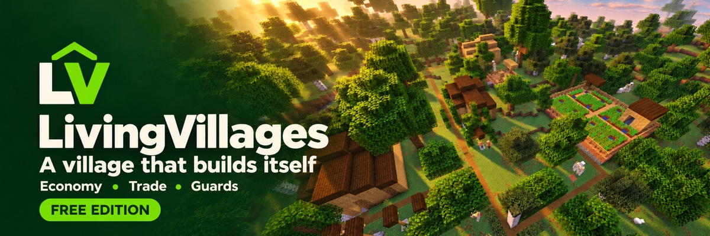
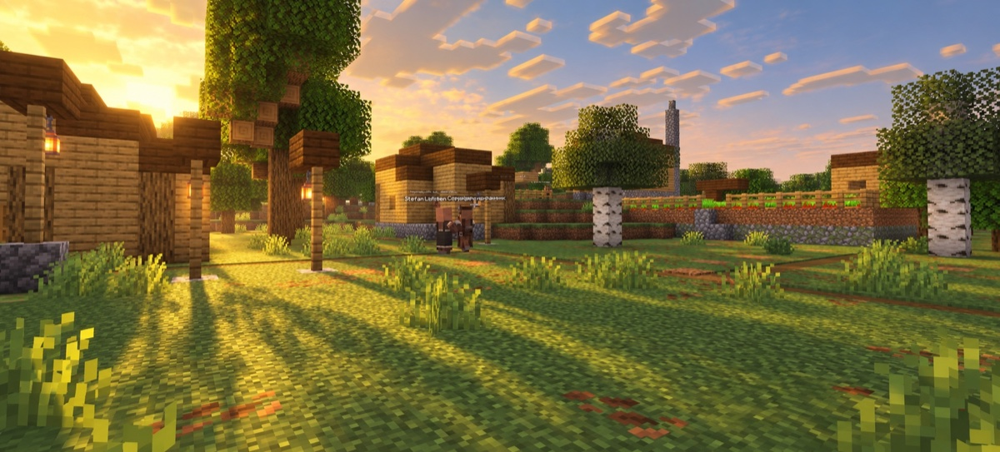
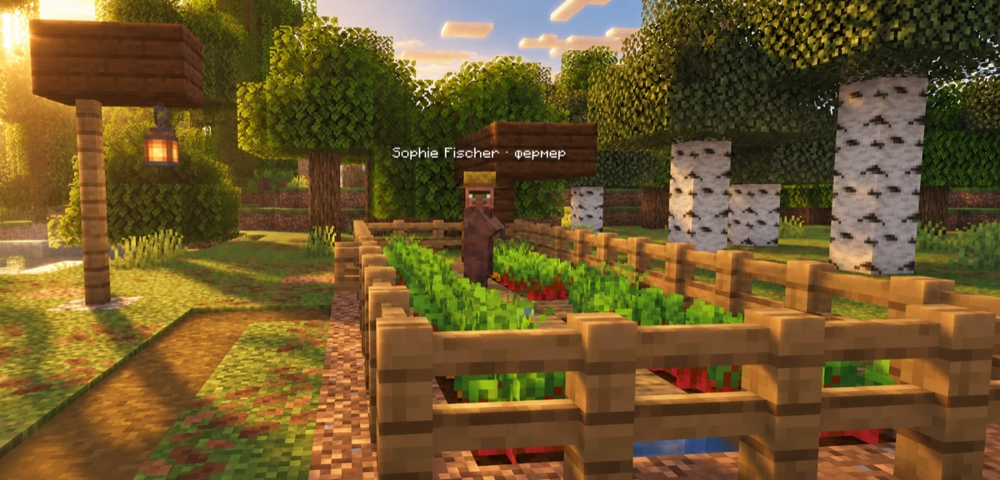
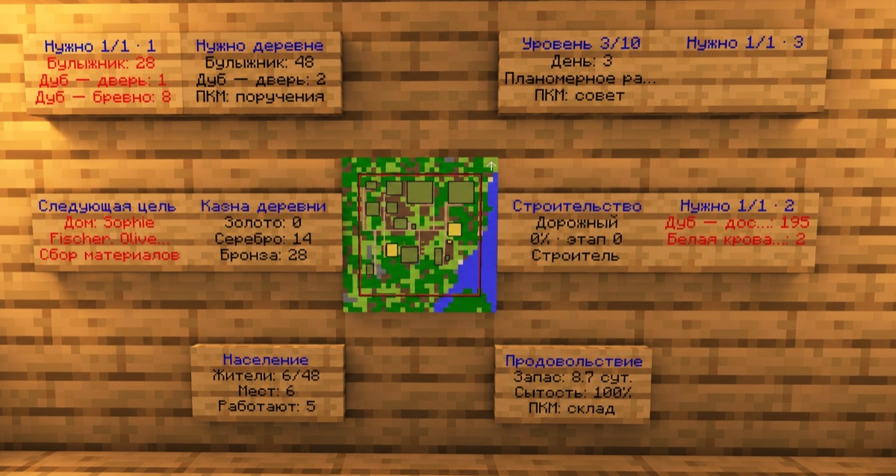

# LivingVillages — Free



<p align="center">
  <strong><a href="https://github.com/TheViniAnd/LivingVillages/releases/latest/download/LivingVillages.jar">⬇ Скачать .JAR</a></strong>
  &nbsp;·&nbsp;
  <a href="https://github.com/TheViniAnd/LivingVillages/releases">Релизы</a>
  &nbsp;·&nbsp;
  <a href="#установка">Установка</a>
  &nbsp;·&nbsp;
  <a href="#команды">Команды</a>
  &nbsp;·&nbsp;
  <a href="README.md">English</a>
</p>

**NPC сами строят свою деревню.** Торгуйте с жителями, помогайте с поставками и наблюдайте, как растёт поселение.

## Строительство и жизнь деревни

Жители добывают ресурсы, создают инструменты, строят дома и рабочие здания. Они работают, питаются, отдыхают и заселяют новое жильё. Местная охрана защищает деревню.



## Экономика и торговля

Монеты, деревенская казна и торговля с учётом потребностей поселения. Выполняйте поручения на поставку, приносите материалы и повышайте доверие жителей.



## Карта и информация о деревне

Карта и информационные таблички показывают население, запасы еды, казну и потребности строительства.



## Бесплатная версия

- Одна культура.
- Уровни деревни 1–3.
- До 12 жителей в деревне.
- До 5 деревень на мир.

## Установка

1. [Скачайте плагин](https://github.com/TheViniAnd/LivingVillages/releases/latest/download/LivingVillages.jar).
2. Поместите JAR в папку `plugins` вашего сервера.
3. Перезапустите сервер.

## Команды

| Команда | Действие |
| --- | --- |
| `/lv help` | Список доступных команд |
| `/lv menu` | Обнаруженные деревни |
| `/lv status` | Состояние деревни |
| `/lv claims` | Получить сохранённые предметы и возвраты |
| `/lv admin` | Управление деревнями |
| `/lv create polevichi [layout]` | Создать деревню |
| `/lv coins <amount> [player]` | Выдать монеты |
| `/lv reload` | Перезагрузить настройки |

Право администратора: `livingvillages.admin`.

## Сборка из исходников

```sh
./gradlew build
```

## Документация

[Настройки](src/main/resources/config.yml) · [Сохранения](docs/PERSISTENCE.md) · [Тестирование](docs/TESTING.md) · [Лицензия](LICENSE)
